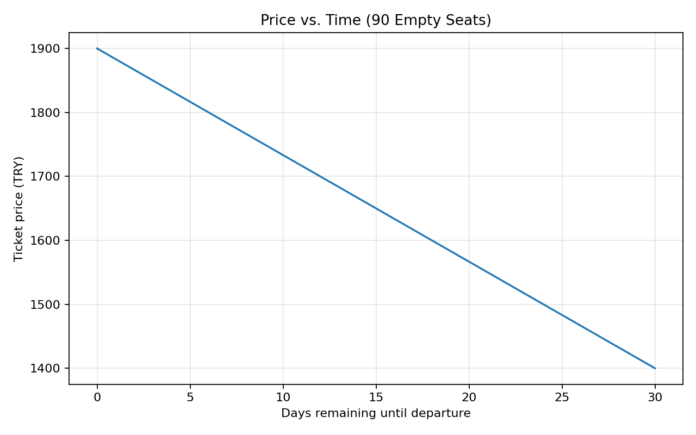
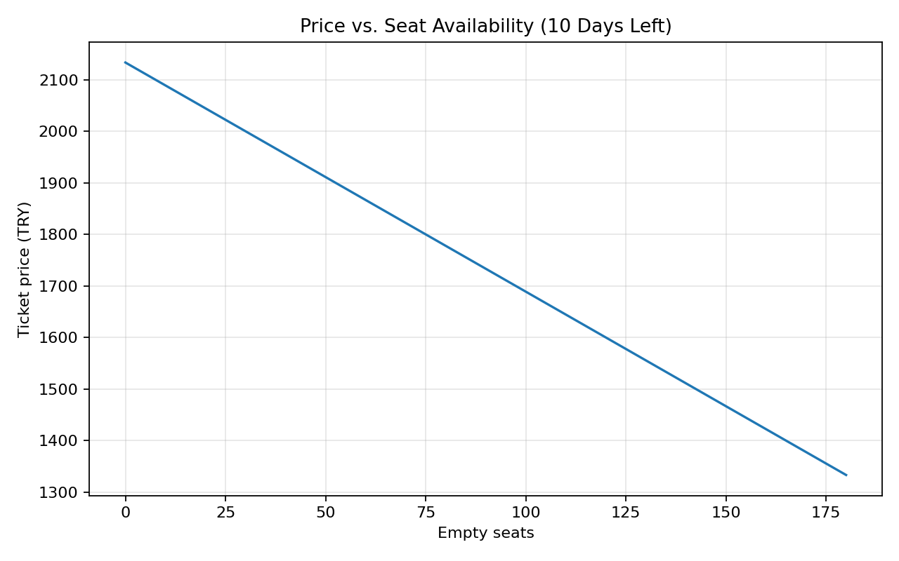

# Airline Dynamic Pricing Simulation

A small Python simulation inspired by an undergraduate TÜBİTAK 2209 research topic on airline pricing and game theory.

## Objective

Explore how a simplified ticket price changes with (1) days remaining until departure and (2) remaining seat availability. All parameters and scenarios are **illustrative, not real airline data**. This is a demonstration of mathematical modeling, **not yet a game-theoretic competition model**.

## Mathematical model

$$
P(t,s)=P_0+\alpha\left(1-\frac{t}{T}\right)+\beta\left(1-\frac{s}{C}\right)
$$

- $P_0=1000$ TRY: base price
- $t$: days left until departure; $T=30$: booking horizon
- $s$: empty seats; $C=180$: aircraft capacity
- $\alpha=500$ TRY: time sensitivity
- $\beta=800$ TRY: seat availability sensitivity

Valid inputs satisfy $0\le t\le T$ and $0\le s\le C$. The model increases price as departure approaches or available seats decrease, holding the other input constant. These are assumptions, not empirical findings.

## Run

Install Python 3, then from this directory:

```bash
python -m pip install -r requirements.txt
python pricing_simulation.py
```

The script prints four example prices and generates two figures.

## Results

### Effect of time (90 empty seats)



### Effect of seat availability (10 days left)



## Limitations and future work

The model does not estimate demand, optimize revenue, use observed airline data, or model competitors. Possible extensions include demand functions, price optimization, and a two-airline strategic pricing game.

## Author

**Şirin Gökcan** — Mathematics undergraduate, Gebze Technical University.
